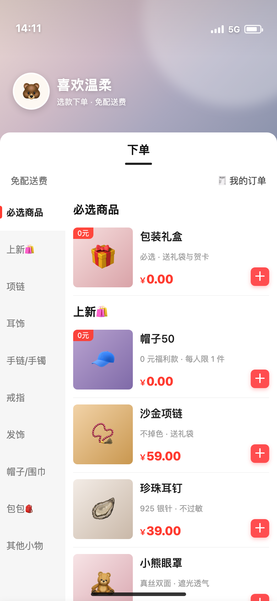
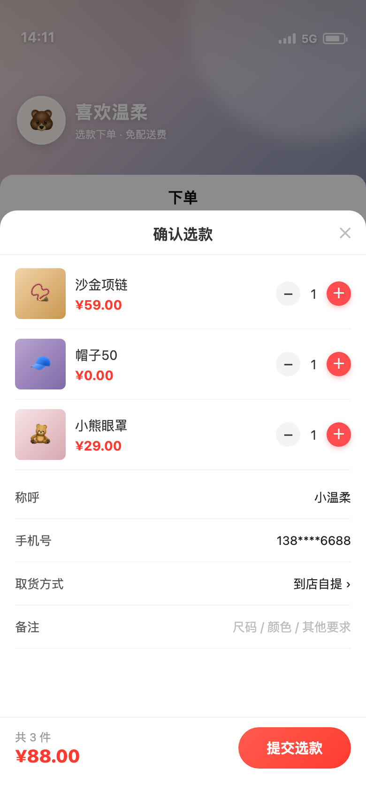
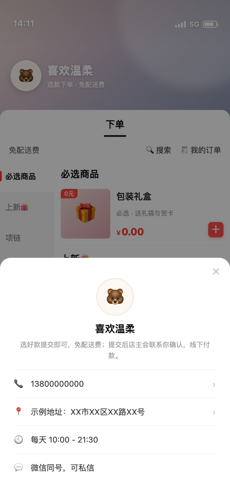

# 选款下单小程序（原生微信小程序 + 云开发）

一个「只选款、不发货、可选不收款」的微信小程序，UI 参考快团团式左右分栏，已包含完整可跑通的选款 → 提交 → 订单 → 店主后台闭环。

| 首页选款 | 确认选款 |
| --- | --- |
|  |  |
| **店铺资料** | **搜索商品** |
|  |  |

> 上面两张图是 `preview/index.html` 的浏览器渲染稿（用于快速看效果）。真机效果请用微信开发者工具导入本目录查看。

> `project.config.json` 里的 `appid` 已换成真实 AppID；`project.private.config.json` 是开发者工具生成的本地配置，已被 `.gitignore` 排除。

## 0. 先分清：小程序本体 vs 浏览器预览

| 路径 | 是什么 | 怎么用 |
|------|--------|--------|
| `app.json`、`app.js`、`app.wxss`、`pages/`、`services/`、`data/`、`cloudfunctions/`、`project.config.json` | **小程序本体**（WXML / WXSS / JS / 云函数），共 28 个文件 | 微信开发者工具「导入项目」选择本目录 |
| `preview/index.html` | 浏览器预览稿：用 HTML/CSS 把界面重画了一遍 | 浏览器直接打开，**不参与上线** |
| `scripts/` | 本地自测脚本（结构校验 + 端到端逻辑测试） | `node scripts/validate-miniapp.js` 等 |

> 为什么要有预览稿：小程序的 WXML/WXSS 只能在微信运行时里渲染，浏览器打不开；没有开发者工具时，用它来看效果和出截图。

---

## 1. 已实现的功能

- **左右分栏选款**：左侧类目固定、右侧商品滚动；点类目跳转、滚商品反选类目（双向联动）
- **加购**：商品卡片 `＋`，底部实时显示「已选 N 件 / 合计 ¥X」
- **确认选款**：数量增减、称呼 / 手机号 / 微信号 / 取货方式 / 备注
- **提交订单**：生成单号，写入云端或本机；提交后跳「我的订单」
- **我的订单**：商品明细、合计、状态、时间
- **店主后台**：订单状态流转（待确认 → 已确认 → 已完成）、商品上下架
- **商品管理**：手机上新增 / 编辑（独立编辑页，不受弹层遮挡）/ 删除商品，改价、改描述、换分类、上下架
- **商品搜索**：顶部搜索，按名称/描述过滤，结果可直接加购
- **店铺资料**：点头像/店名弹出电话、地址、营业时间，可一键拨号、复制地址
- **权限控制**：店主入口只对管理员显示——云模式校验 openid 白名单，本地演示模式需管理密码
- **0 元商品**：`帽子50 ¥0.00` 这类福利款可正常下单、正常统计
- **两种运行模式**：不配云环境 = 本地演示（数据存手机），配云开发 = 多人真实下单、订单汇总到云端

## 2. 快速开始（3 分钟看到界面）

1. 下载安装[微信开发者工具](https://developers.weixin.qq.com/miniprogram/dev/devtools/download.html)
2. 「导入项目」→ 目录选择本文件夹 `wechat-shop`
3. AppID 填你自己的；没有的话选「测试号」
4. 直接编译即可运行（此时是本地演示模式，不需要任何后端）

## 3. 接入云开发（让所有人的订单汇总到云端）

1. 开发者工具顶部点「云开发」→ 开通 → 记下**环境 ID**（形如 `shop-3g0abc123`）
2. 打开 `services/config.js`，把 `cloudEnv` 填成该环境 ID
3. 云开发控制台 → 数据库 → 新建集合：`products`、`orders`
   - `products`：权限设为「所有用户可读，仅管理端可写」
   - `orders`：权限设为「仅创建者可读写」（云函数不受此限制）
4. 右键 `cloudfunctions/shop` →「上传并部署：云端安装依赖」
5. 云开发控制台 → 云函数 → `shop` → 配置 → 环境变量：
   `ADMIN_OPENIDS = 你的 openid`（多个用英文逗号分隔）
   - 拿 openid：云开发控制台 →「用户管理」里找到自己的记录；或先用店主微信点一次「店主入口」，无权限页会显示并允许复制自己的 openid
6. 重新编译：首次进入会自动写入 14 个演示商品（`seed` action）

> 商品后续在「云开发控制台 → 数据库 → products」里增删改，或在小程序「我的订单 → 店主入口 → 商品」里新增/编辑/删除。
>
> 本地演示模式点「店主入口」会要求管理密码，默认 `1234`（改 `services/config.js` 的 `localAdminPin`）。

## 4. 不接在线支付（当前默认）

当前流程是「提交选款单 → 店主线下联系确认 → 线下收款」，因此：

- 不需要微信支付商户号，也就不需要企业/个体户主体才能收款
- 订单里记录了称呼、手机号、微信、取货方式和备注，店主照着联系即可
- 如果以后要在线收款：在云函数 `submitOrder` 后接[微信支付](https://pay.wechatpay.cn/)，并在 `pages/cart` 提交成功后调用 `wx.requestPayment`；此时必须用**单位主体**（个体户/公司）开通商户号

## 5. 目录结构

```
wechat-shop/
├── app.js / app.json / app.wxss      小程序入口与全局样式
├── project.config.json               开发者工具配置（appid 记得改成自己的）
├── data/products.js                  演示商品与分类（本地模式数据源）
├── services/
│   ├── config.js                     云环境 ID、管理员配置
│   ├── store.js                      购物车 / 本地订单 / 商品改动缓存
│   └── api.js                        数据层：有云走云函数，无云走本地
├── pages/
│   ├── index/                        首页：左右分栏选款
│   ├── cart/                         确认选款 + 提交
│   ├── orders/                       我的订单
│   └── admin/                        店主后台（订单 / 商品）
├── cloudfunctions/shop/              云函数（catalog / seed / submitOrder / myOrders / listOrders / updateOrderStatus / saveProduct）
├── preview/index.html                浏览器预览稿（截图用）
└── docs/
    ├── 备案与资质.md                  备案、主体、类目、费用、时效
    └── 方案对比.md                    快团团 / 群接龙 / 微信小店 / SaaS / 自研
```

## 6. 上线前必须做的事

代码只是其中一步，真正上线还差主体、认证、备案、类目。详见 [`docs/备案与资质.md`](docs/备案与资质.md)，要点：

1. 注册小程序（邮箱 + 个体户营业执照）
2. 微信认证（个体户 30 元/年优惠价；个人 30 元/年；企业 300 元/年）
3. **小程序备案**（2023-09-01 起强制；平台初审 1–2 个工作日，管局 1–20 个工作日；未备案发布会报 `86369`）
4. 选对服务类目：**商家自营 → 时尚首饰**（项链/耳饰/手链/戒指/发饰，无需额外资质）；帽子/包包加「服饰内衣」；眼罩/指甲刀加「个护家清」。个体户执照即可
5. 配置「用户隐私保护指引」（收集手机号必须声明）
6. 提审 → 发布

> 本项目按「个体户 + 不做在线收款 + 饰品」配置：不接微信支付、不发货、到店自提/线下收款。
>
> 本仓库只包含代码、设计与开发进度；上线/备案相关材料（主体资质、备案填写、方案对比）不纳入版本库。

## 7. 常见改动位置

| 想改什么 | 改哪里 |
| --- | --- |
| 店名、公告 | `data/products.js` 的 `shop`（云模式改 `cloudfunctions/shop/seed.js`） |
| 电话、地址、营业时间 | 同上，`shop.phone / address / hours / wechat` |
| 商品、价格、分类 | `data/products.js`（本地）/ 云数据库 `products`（线上） |
| 主题色 | `app.wxss` 与页面 `wxss` 里的 `#ff3b30 / #ff4d4f` |
| 取货方式选项 | `pages/cart/cart.js` 的 `pickups` |
| 提交成功文案 | `services/config.js` 的 `submitTip` |
| 管理员 | 云模式：云函数环境变量 `ADMIN_OPENIDS`（openid 白名单）；本地演示：`services/config.js` 的 `localAdminPin`（默认 `1234`） |
| 加商品 / 改价 | 小程序里「我的订单 → 店主入口 → 商品」；本地模式存本机，云模式写数据库 |

## 8. 开发约定（分支）

| 分支 | 用途 |
|------|------|
| `main` | 稳定分支，只接受从 `dev` 合并的发布版本 |
| `dev` | 日常开发分支，所有改动先提交到这里 |

流程：

```bash
git checkout dev
# ... 改代码 ...
node scripts/validate-miniapp.js && node scripts/smoke-test.js
git add -A && git commit -m "feat: xxx" && git push
# 发布时
git checkout main && git merge --no-ff dev && git push
```

提交信息前缀：`feat:` 新功能 / `fix:` 修复 / `docs:` 文档 / `chore:` 杂项。

## 9. 云开发费用与后台

**费用**（据 2026-10 官方计费页，政策可能调整，以控制台为准）：

| 项 | 内容 |
|----|------|
| 计费模式 | 基础套餐 + 按量付费 |
| 基础套餐 | **19.9 元/月**（原价 39，5 折长期有效）：20 万次调用/月、2GB 容量、2GB 云函数外网流量、10 万 GBs、5GB CDN/月、500 QPS |
| 免费体验 | 新用户 6 个月免费环境；2025-02-19 起活动：**未发布上线阶段免费，发布后第 15 天到期**，需转付费（活动截止 2026-12-31） |
| 按量单价 | 调用 0.5 元/万次；容量 0.1 元/GB/日；云函数外网出流量 0.8 元/GB |

> 小店体量远低于套餐配额（20 万次/月 ≈ 每天 6600 次），实际支出就是 19.9 元/月。注意：免费环境在小程序上线后第 15 天到期，**到期 7 天后未续费会释放数据**。

**商品/订单在哪里管**：

1. **云开发控制台 → 数据库 → `products` / `orders`**：直接增删改记录（免费，适合偶尔维护）
2. **小程序内「我的订单 → 店主入口 → 商品」**：新增 / 编辑 / 删除 / 改价 / 上下架（已实现，手机即可操作）
3. 后续可加 Web 管理后台（云开发静态托管，按量计费，成本极低）
